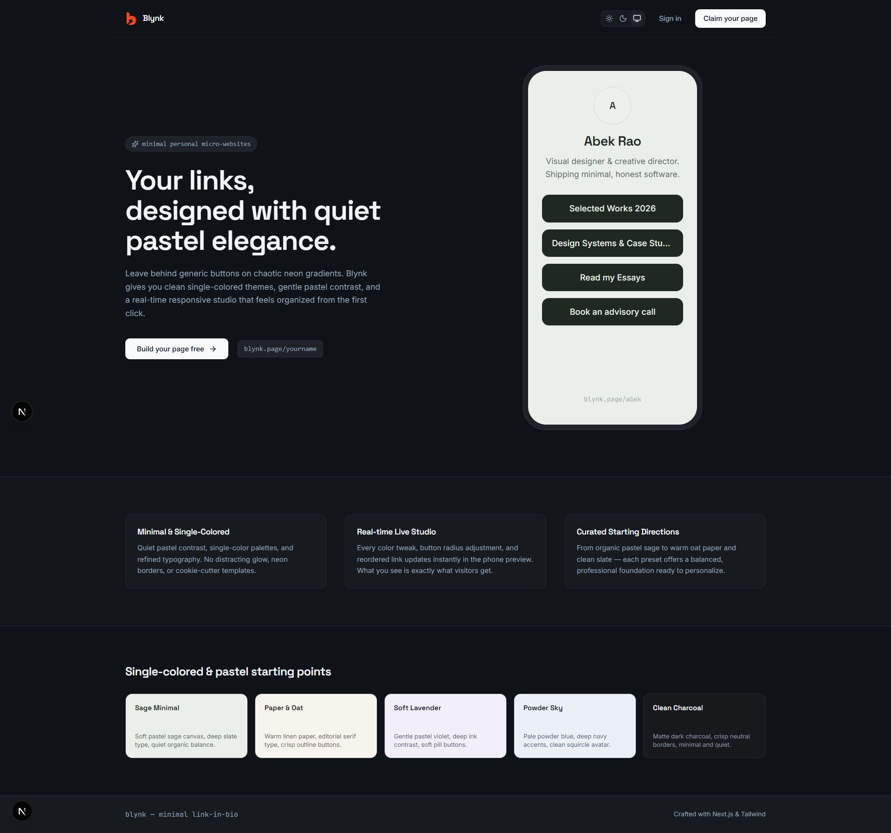
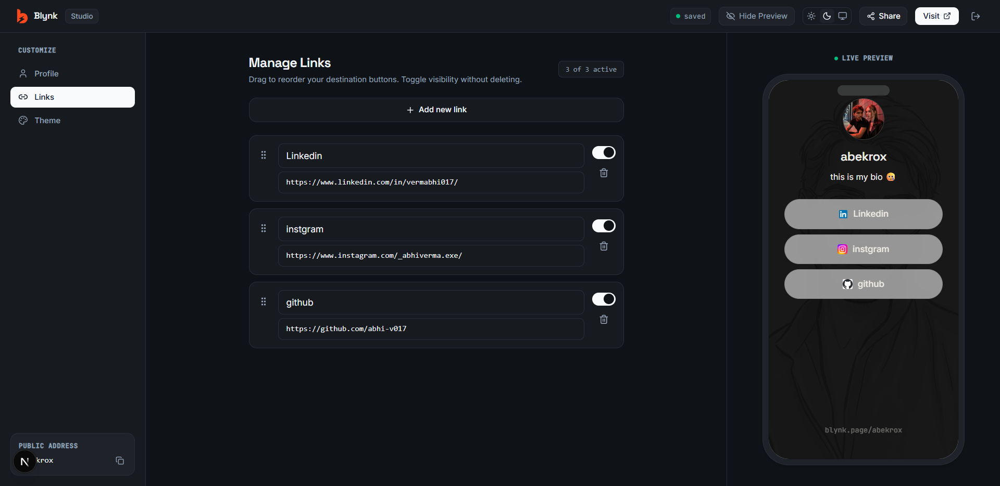
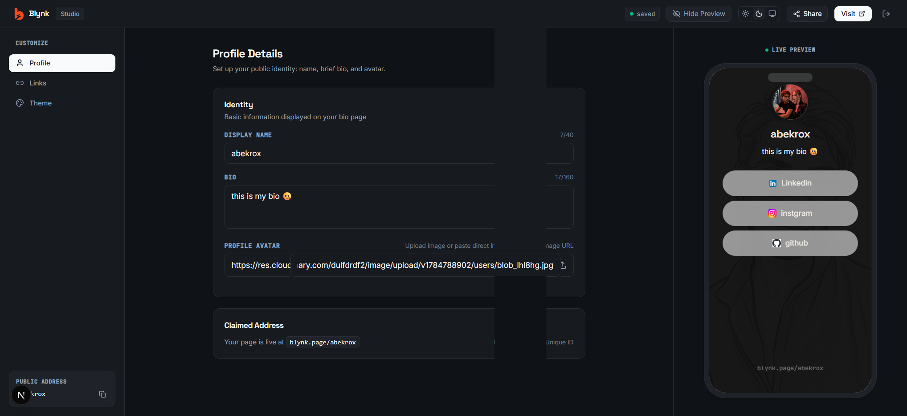
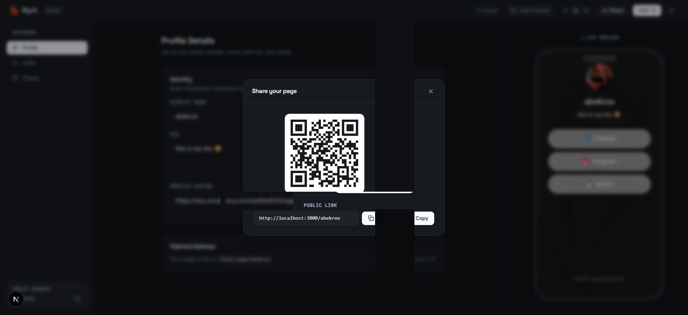
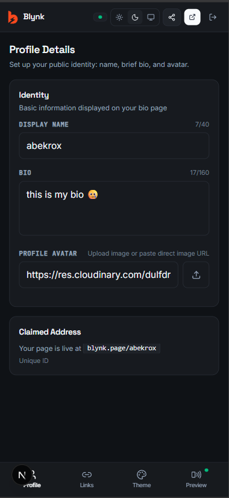
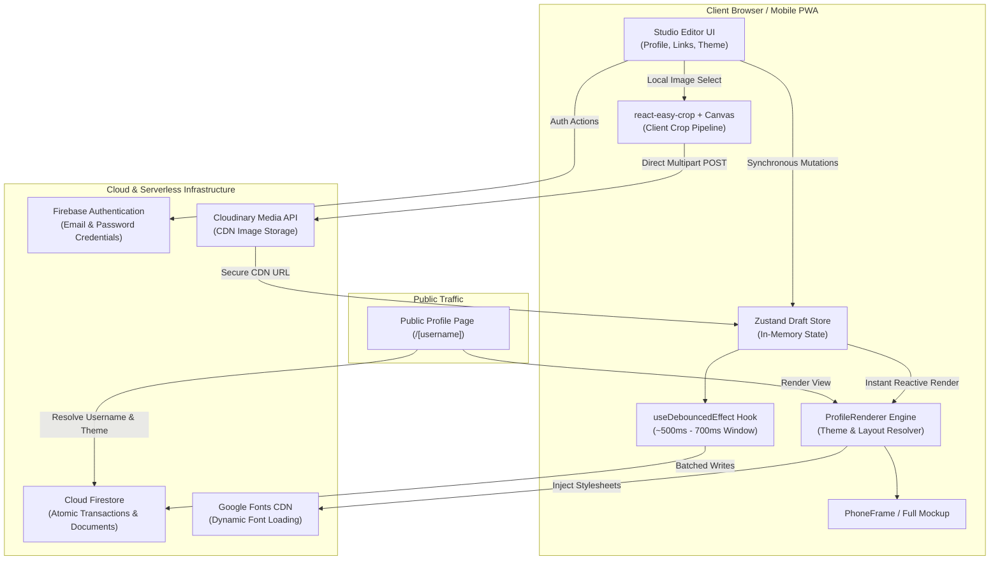

# Blynk — Personal Micro-Website & Link-in-Bio Platform

<p align="center">
  
</p>

<p align="center">
  <strong>A high-performance, design-first personal micro-website builder built with Next.js 16, React 19, TypeScript, and Tailwind CSS v4.</strong>
</p>

<p align="center">
  
  
  
  
  
  
  
  
</p>

---

## 📌 Executive Summary

**Blynk** is a modern link-in-bio platform engineered for creators, engineers, and digital freelancers who want a distinct digital identity rather than cookie-cutter templates. 

Unlike traditional platforms constrained to rigid button stacks on neon gradients, Blynk provides an opinionated yet flexible canvas featuring **single-colored & soft pastel contrast theming**, **independent Google Font pairings**, **frosted glass and outline button treatments**, **fluid drag-and-drop link ordering**, and a **real-time live studio preview** with zero drift between editing and production delivery.

---

## 📸 Application Showcase

### 1. Minimal Landing Page (Light & Dark Modes)
*Designed with quiet pastel elegance, typography-first hierarchy, and responsive preview.*

| Light Mode | Dark Mode |
|:---:|:---:|
|  |  |

---

### 2. Live Studio Dashboard
*Real-time reactive editor with instant phone mockup preview, debounced auto-saving, and unified styling.*

| Theme & Appearance Customizer | Links Management (`@dnd-kit`) |
|:---:|:---:|
|  |  |

| Identity & Profile Editor | Interactive QR Code & Link Sharing |
|:---:|:---:|
|  |  |

---

### 3. Native-Grade Android & Tablet Experience
*Thumb-friendly bottom navigation, touch drag-and-drop reordering, and dedicated mobile preview modes.*

<p align="center">
  
  &nbsp;&nbsp;&nbsp;&nbsp;
  
</p>
<p align="center">
  <em>Left: Mobile Profile Editor with Cloudinary upload &bull; Right: Interactive Live Preview with Frame/Full switcher and bottom navigation bar.</em>
</p>

---

## 🚀 Key Engineering Highlights

### 1. Atomic Concurrency Control (Race-Free Username Reservation)
To guarantee that two concurrent registration requests cannot claim the same handle, Blynk uses **Cloud Firestore ACID Transactions** (`runTransaction`). The operation atomically verifies `/usernames/{username}`, reserves the handle mapping, creates the user profile, and initializes default theme preferences within a single commit.

```ts
// Atomic handle reservation in src/lib/firestore.ts
await runTransaction(db, async (tx) => {
  const existing = await tx.get(usernameRef(uname));
  if (existing.exists()) {
    throw new Error("USERNAME_TAKEN");
  }
  tx.set(usernameRef(uname), { userId });
  tx.set(userRef(userId), profileData);
  tx.set(themeRef(userId), defaultThemeData);
});
```

### 2. Zero-Drift Unified Rendering Engine (`ProfileRenderer`)
A single, highly optimized rendering engine powers both the **in-studio interactive phone mockup** (`scale="preview"`) and the **public production page** (`scale="full"` at `/{username}`).
- Eliminates visual drift between editing state and public delivery.
- Dynamically calculates typography sizing, button border radiuses, and frosted glass luminance based on the background color.
- Automatically fetches and displays domain favicons via Google S2 Favicon service or custom user emoji badges.

### 3. Reactive Draft Store & Debounced Network Persistence
- **60 FPS Local Reactivity:** Powered by [Zustand](https://github.com/pmndrs/zustand) (`editor-store.ts`), every slider tick or color change updates in-memory state instantly without lag or prop drilling.
- **Intelligent Auto-Save Pipeline:** A custom [`useDebouncedEffect`](src/hooks/useDebouncedEffect.ts) hook batches edits and debounces network writes to Firestore (~700ms threshold for profile/theme, ~500ms for link text).
- **Status Indicator:** Live UI badge transitions seamlessly between `Draft` $\rightarrow$ `Saving...` $\rightarrow$ `All changes saved`.

### 4. Client-Side Image Crop & Direct Cloudinary Upload Pipeline
- High-resolution avatars and background images are cropped locally in the browser using [`react-easy-crop`](https://github.com/ValentinH/react-easy-crop).
- Canvas offsets and rotation calculations execute in an in-memory `HTMLCanvasElement` (`src/lib/cropImage.ts`), compressing output into an optimized JPEG blob.
- Uploads stream directly to Cloudinary's secure media CDN via unsigned client upload presets, keeping server infrastructure lightweight.

### 5. Mobile-First & Touch-Optimized Responsive Architecture
- **Dynamic Viewport Height (`100dvh`):** Eliminates layout shifts and hidden buttons caused by mobile browser URL bar toggles on Android and iOS.
- **Touch-Friendly Drag & Drop:** Configured `@dnd-kit` with dual `PointerSensor` and `TouchSensor` (180ms delay, 8px tolerance), allowing fluid vertical page scrolling while preserving responsive handle dragging.
- **Anti-Zoom Form Inputs:** Form controls use `text-base sm:text-sm` (16px base font on mobile) to prevent mobile browser viewport auto-zooming.
- **Native Web Share Integration:** Supports the Web Share API (`navigator.share`) on mobile devices, allowing 1-tap sharing to WhatsApp, Instagram, Telegram, and Messages.

### 6. Dual-Mode Pastel Aesthetic & Zero-Neon Design System
- Built entirely on **Tailwind CSS v4** using CSS design tokens (`@theme inline`).
- Out-of-the-box support for **Light Mode**, **Dark Mode**, and **System Preference** with no flash of unstyled theme (FOUT).
- Curated palette of single-color and soft pastel directions (Sage Minimal, Paper & Oat, Soft Lavender, Powder Sky, Clean Charcoal) that prioritize contrast, readability, and quiet professionalism over garish neon glow.

---

## 🛠️ Technology Stack & Architectural Decisions

| Layer | Technology | Decision Rationale |
|---|---|---|
| **Framework** | **Next.js 16 (App Router)** | Modern server/client boundary architecture, nested layouts (`dashboard/layout.tsx`), route grouping `(auth)`, and fast route transitions. |
| **UI Library** | **React 19** | Modern concurrent rendering, clean hook composition, and optimized client state transitions. |
| **Language** | **TypeScript 5** | Strict type safety for data models (`UserProfile`, `ThemeConfig`, `LinkItem`) across Firestore boundaries. |
| **Styling** | **Tailwind CSS v4** | Next-generation CSS engine using `@import "tailwindcss"` and inline theme variables for fast builds and low bundle size. |
| **Client State** | **Zustand 5** | Minimal boilerplate, unopinionated in-memory store for instantaneous preview hydration. |
| **Authentication** | **Firebase Auth** | Robust email/password authentication managed via React context (`auth-context.tsx`). |
| **Database** | **Cloud Firestore** | Serverless NoSQL document database with real-time capabilities and atomic transaction support. |
| **Media Processing**| **react-easy-crop + Cloudinary** | Interactive canvas-based cropping on the client combined with reliable CDN image storage. |
| **Drag & Drop** | **@dnd-kit (Core & Sortable)** | Modular, accessible drag-and-drop primitives optimized for both mouse and touch devices. |
| **Iconography** | **Lucide React** | Consistent, lightweight SVG icon set. |
| **QR Code** | **react-qr-code** | Clean SVG QR generation for mobile profile discovery. |

---

## 🏛️ System Architecture & Data Flow



---

## 🗄️ Database Schema & Data Models

### Firestore Collections

```
/usernames/{username}
  └── userId: string               # Unique mapping enforcing single ownership

/users/{userId}
  ├── userId: string               # Firebase Auth UID
  ├── username: string             # Claimed URL slug (lowercase, immutable)
  ├── displayName: string          # Public display title
  ├── bio: string                  # Short biography (up to 160 chars)
  ├── profilePic: string           # CDN image URL or empty string
  ├── createdAt: number            # Epoch timestamp (ms)
  └── published: boolean           # Public visibility flag

/users/{userId}/links/{linkId}
  ├── title: string                # Destination label
  ├── url: string                  # Target hyperlink
  ├── order: number                # Sort order index (0-indexed)
  ├── isActive: boolean            # Visibility toggle without deletion
  └── icon?: string                # Optional custom emoji badge

/themes/{userId}
  ├── userId: string
  ├── presetId: string             # "sage-minimal" | "paper-oat" | "soft-lavender" | ...
  ├── background: {
  │     type: "color" | "gradient" | "image",
  │     color: string, color2: string, gradientAngle: number,
  │     imageUrl: string, overlay: number
  │   }
  ├── font: {
  │     family: string, bodyFamily: string,
  │     color: string, mutedColor: string, size: "sm" | "md" | "lg"
  │   }
  ├── button: {
  │     shape: "sharp" | "soft" | "pill",
  │     fill: "solid" | "outline" | "glass",
  │     bgColor: string, textColor: string, borderColor: string,
  │     spacing: "compact" | "normal" | "roomy",
  │     iconStyle: "none" | "auto" | "custom"
  │   }
  ├── layout: "stack" | "grid"
  ├── animation: "none" | "fade" | "rise" | "pop"
  └── avatarShape: "circle" | "square" | "squircle"
```

### Security Rules Highlights ([`firestore.rules`](firestore.rules))
- **Public Read Access:** Profiles, links, and themes are publicly queryable to render `/{username}` for unauthenticated visitors.
- **Strict Owner-Only Mutation:** All create, update, and delete operations enforce `request.auth.uid == userId`.
- **Immutable Usernames:** The `/usernames/{username}` collection disallows updates and deletions after initial creation, preventing handle hijacking.
- **Tamper Protection:** Users cannot alter `userId` or `username` attributes within profile document updates.

---

## 📂 Project Structure

```
├── blynck/                       # Application screenshots & visual assets
├── public/                       # Static assets & brand vectors
├── src/
│   ├── app/
│   │   ├── (auth)/               # Auth route group (isolated layout)
│   │   │   ├── login/page.tsx    # Responsive email/password sign-in
│   │   │   └── register/page.tsx # Atomic handle reservation & onboarding
│   │   ├── dashboard/            # Studio environment
│   │   │   ├── layout.tsx        # Responsive shell: header, rail/sidebar & preview
│   │   │   ├── links/page.tsx    # Touch-friendly drag-and-drop link manager
│   │   │   ├── profile/page.tsx  # Identity, bio, and avatar cropper
│   │   │   └── theme/page.tsx    # Pastel preset gallery & design controls
│   │   ├── [username]/page.tsx   # Public profile view (high-speed delivery)
│   │   ├── globals.css           # Tailwind v4 tokens & touch optimizations
│   │   ├── layout.tsx            # Root layout with ThemeProvider & AuthProvider
│   │   └── page.tsx              # Minimal landing page with interactive demo
│   ├── components/
│   │   ├── GoogleFontLoader.tsx  # Dynamic Google Fonts stylesheet injector
│   │   ├── ImageUpload.tsx       # Canvas-based cropper & Cloudinary client uploader
│   │   ├── PhoneFrame.tsx        # Adaptive responsive phone chassis mockup
│   │   ├── ProfileRenderer.tsx   # Core unified rendering engine
│   │   ├── ShareModal.tsx        # QR code generator & Web Share API modal
│   │   ├── SortableLinkRow.tsx   # Touch-optimized sortable row item
│   │   └── ui.tsx                # Accessible design system primitives & ThemeToggle
│   ├── hooks/
│   │   └── useDebouncedEffect.ts # Debounced execution hook for auto-save
│   └── lib/
│       ├── auth-context.tsx      # Firebase auth provider & state listener
│       ├── cropImage.ts          # HTML5 Canvas crop & rotation utility
│       ├── editor-store.ts       # Zustand in-memory reactive draft store
│       ├── firebase.ts           # Firebase client app initialization
│       ├── firestore.ts          # Type-safe database queries & transactions
│       ├── fonts.ts              # Supported font metadata & stylesheet builders
│       ├── presets.ts            # Curated pastel theme presets & swatches
│       ├── theme-provider.tsx    # Light/Dark/System theme context
│       └── types.ts              # TypeScript type definitions
├── firestore.rules               # Production Firestore security rules
└── storage.rules                 # Firebase Storage bucket security rules
```

---

## ⚡ Getting Started

### Prerequisites
- **Node.js**: `18.18.0` or later
- **Package Manager**: `npm`, `pnpm`, or `yarn`
- **Firebase Project**: [Firebase Console](https://console.firebase.google.com/)
- **Cloudinary Account**: [Cloudinary Console](https://cloudinary.com/) (Free tier)

### 1. Clone & Install Dependencies
```bash
git clone https://github.com/your-username/blynk.git
cd blynk
npm install
```

### 2. Environment Configuration
Create a `.env.local` file in the root directory:

```env
# Firebase Client Configuration (Project Settings > General > Your Apps)
NEXT_PUBLIC_FIREBASE_API_KEY=your_api_key_here
NEXT_PUBLIC_FIREBASE_AUTH_DOMAIN=your_project.firebaseapp.com
NEXT_PUBLIC_FIREBASE_PROJECT_ID=your_project_id
NEXT_PUBLIC_FIREBASE_STORAGE_BUCKET=your_project.appspot.com
NEXT_PUBLIC_FIREBASE_MESSAGING_SENDER_ID=your_sender_id
NEXT_PUBLIC_FIREBASE_APP_ID=your_app_id

# Cloudinary Unsigned Upload Configuration
NEXT_PUBLIC_CLOUDINARY_CLOUD_NAME=your_cloud_name
NEXT_PUBLIC_CLOUDINARY_UPLOAD_PRESET=your_unsigned_upload_preset
```

### 3. Deploy Firestore Security Rules
Deploy rules via the Firebase CLI:
```bash
firebase deploy --only firestore:rules
```
*(Alternatively, copy the contents of `firestore.rules` directly into the Firestore Console and click **Publish**).*

### 4. Run Development Server
```bash
npm run dev
```
Open [http://localhost:3000](http://localhost:3000) in your browser.

---

## 📦 Available Scripts

| Command | Description |
|---|---|
| `npm run dev` | Starts the local development server with Hot Module Replacement (HMR). |
| `npm run build` | Compiles optimized production bundle with TypeScript type-checking. |
| `npm run start` | Runs the production-built application. |
| `npm run lint` | Runs ESLint analysis across TypeScript and JSX files. |

---

## 🌐 Production Deployment

Blynk is designed for zero-config serverless deployment on [Vercel](https://vercel.com/):

1. Push your code to GitHub / GitLab / Bitbucket.
2. Import the repository into Vercel.
3. Configure the environment variables specified in `.env.local`.
4. Click **Deploy**.

All client-side Firebase and Cloudinary credentials are safe for public exposure by design.

---

## 📄 License

Distributed under the **MIT License**. See `LICENSE` for more information.

---

<p align="center">
  <strong>Crafted with care by Abhi Verma</strong> &bull; 
  <a href="https://linkedin.com/in/vermabhi017/">LinkedIn</a> &bull; 
  <a href="https://github.com/abhi-v017">GitHub</a>
</p>
