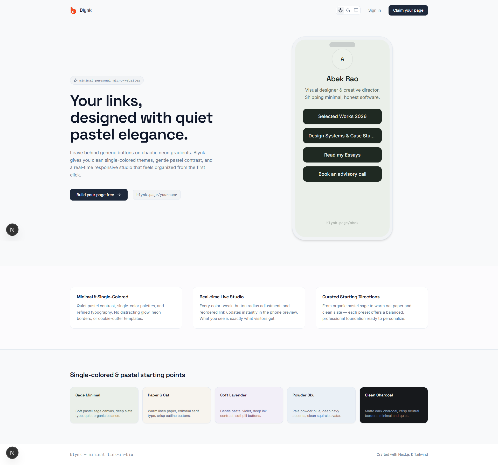
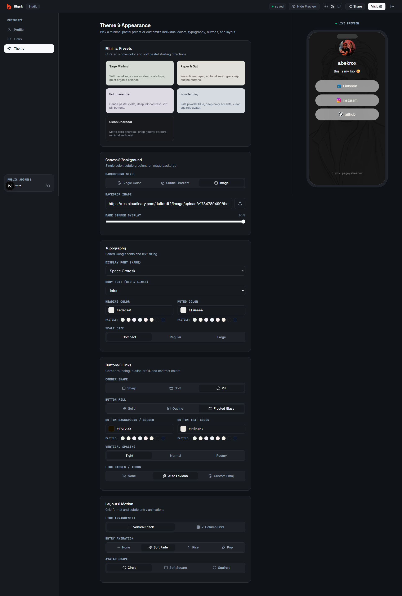
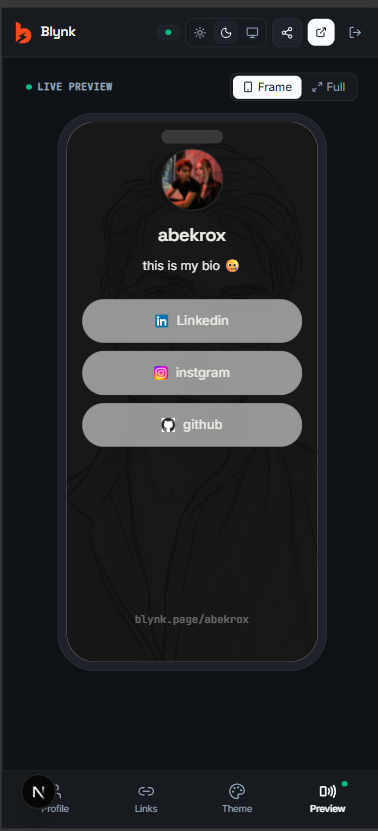

# Blynk — Minimal Link-in-Bio Platform

A clean, responsive link-in-bio web application built with **Next.js 16**, **React 19**, **TypeScript**, and **Firebase**. It allows users to build a personal micro-website with customizable pastel themes, live phone preview, and touch-friendly drag-and-drop link reordering.

---

### 🚀 Live Demo & Recruiter Test Account

- **Live Application:** [https://blynk-omega.vercel.app/](https://blynk-omega.vercel.app/) *(or your live Vercel link)*
- **Sample Bio Page:** `/demo`
- **Recruiter Demo Credentials:**
  - **Email:** `demo@blynk.app`
  - **Password:** `Password123!`
  - *(Or simply click the **"⚡ 1-Click Recruiter Demo Login"** button on the sign-in page)*

---

## 📸 Screenshots

| Landing Page (Light & Dark) | Studio Editor & Live Preview |
|:---:|:---:|
|  |  |

| Link Management (`@dnd-kit`) | Mobile Responsive View |
|:---:|:---:|
|  |  |

---

## ✨ Key Features

- **⚡ Live Studio Preview:** Split-screen editor with a real-time phone preview that updates instantly as you customize your profile.
- **🎨 Minimal Pastel Themes:** Single-color and soft-pastel presets, light/dark mode support, custom Google font pairings, and button styles.
- **🖐️ Drag-and-Drop Sorting:** Reorder links smoothly on both desktop and mobile touchscreens using `@dnd-kit`.
- **✂️ Avatar & Image Cropping:** Interactive client-side image cropper (`react-easy-crop`) with direct upload to Cloudinary.
- **🔒 Authentication & Database:** Email/Password authentication and real-time database powered by Firebase Auth & Cloud Firestore.
- **📱 Fully Responsive:** Optimized for mobile and tablet with dynamic viewport height (`100dvh`), thumb navigation, and native Web Share API support.

---

## 🛠️ Tech Stack

- **Frontend:** Next.js 16 (App Router), React 19, TypeScript
- **Styling:** Tailwind CSS v4, Lucide Icons
- **State Management:** Zustand (in-memory draft store)
- **Database & Auth:** Firebase Authentication, Cloud Firestore
- **Image Storage:** Cloudinary
- **Drag & Drop:** `@dnd-kit` (Core & Sortable)

---

## 🚀 Getting Started (Run Locally)

### 1. Clone the repository & install dependencies
```bash
git clone https://github.com/abhi-v017/blynk.git
cd blynk
npm install
```

### 2. Set up environment variables
Create a `.env.local` file in the root directory:
```env
NEXT_PUBLIC_FIREBASE_API_KEY=your_firebase_api_key
NEXT_PUBLIC_FIREBASE_AUTH_DOMAIN=your_project.firebaseapp.com
NEXT_PUBLIC_FIREBASE_PROJECT_ID=your_project_id
NEXT_PUBLIC_FIREBASE_STORAGE_BUCKET=your_project.firebasestorage.app
NEXT_PUBLIC_FIREBASE_MESSAGING_SENDER_ID=your_sender_id
NEXT_PUBLIC_FIREBASE_APP_ID=your_app_id

# Cloudinary (for image uploads)
NEXT_PUBLIC_CLOUDINARY_CLOUD_NAME=your_cloud_name
NEXT_PUBLIC_CLOUDINARY_UPLOAD_PRESET=your_preset
```

### 3. Run the development server
```bash
npm run dev
```
Open [http://localhost:3000](http://localhost:3000) in your browser.

---

## 📦 Available Scripts

- `npm run dev` — Starts local development server
- `npm run build` — Compiles production build
- `npm run lint` — Runs ESLint checks
- `node scripts/seed-demo.mjs` — Seeds the recruiter demo account in Firestore

---

## 👨‍💻 Author

**Abhi Verma**
- GitHub: [@abhi-v017](https://github.com/abhi-v017)
- LinkedIn: [Abhi Verma](https://linkedin.com/in/vermabhi017/)
